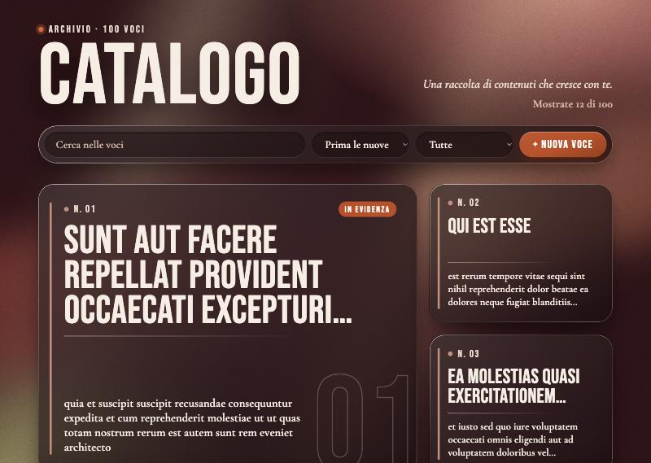
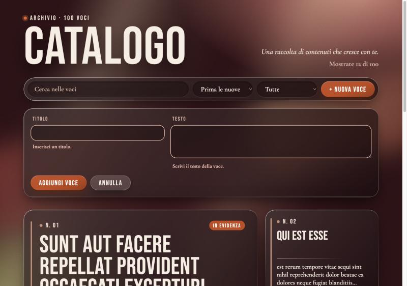
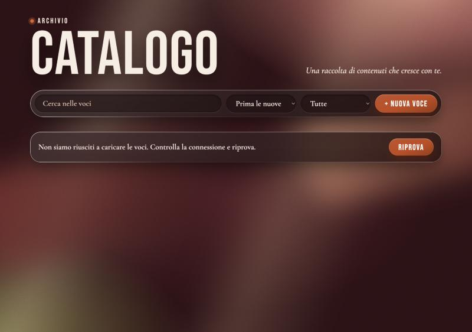
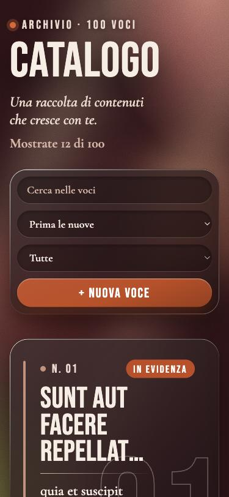

# Catalogo

Una piccola interfaccia per gestire un catalogo di contenuti, fatta per la challenge frontend di Naxos. I dati arrivano da [jsonplaceholder](https://jsonplaceholder.typicode.com/posts): cento post con titolo e testo, senza immagini.



| Form con i campi vuoti | API non disponibile | Da telefono |
|---|---|---|
|  |  |  |

## Prima di iniziare

**Da dove parto.** Prima voglio capire chi userà la pagina e che aspetto avrà. Poi carico i dati, pensando a cosa vede chi aspetta e a cosa succede se qualcosa va storto. Alla fine aggiungo form, ricerca e ordinamento.

**Cosa conta di più.** Che sia facile leggere, aggiungere e ritrovare una voce, e che ogni errore spieghi cosa è successo. Preferisco poche funzioni curate.

**I miei dubbi.** Il testo non dice chi usa l'interfaccia: immagino chi gestisce un catalogo di contenuti. Il POST di jsonplaceholder non salva davvero, quindi le voci nuove le tengo in locale. E i testi dei post sono lunghi, quindi in lista li taglio.

## Come avviarlo

Serve Node.js (l'ho provato con la versione 24).

```bash
npm install
npm run dev
```

Poi apri l'indirizzo che compare nel terminale, di solito `http://localhost:5173`.

## Cosa ho fatto e perché

La prima domanda che mi sono fatta è stata: chi usa questa pagina? Il testo della challenge non lo dice. Ho deciso che è chi gestisce il catalogo, non chi lo sfoglia, e da lì sono venute quasi tutte le altre scelte.

Chi gestisce passa più tempo a cercare e controllare che ad aggiungere. Per questo la lista è la prima cosa che si vede e il form per una nuova voce resta chiuso finché non lo apri. Ricerca, ordinamento e il filtro tra le voci aggiunte da me e quelle dell'archivio servono a ritrovare le cose in fretta. Le voci arrivano dodici alla volta, così la pagina non diventa un muro di cento card.

Nei dati c'è solo testo, quindi ho puntato su tipografia e profondità: titoli in Bebas Neue, testo in Cormorant Garamond, card in vetro su uno sfondo bordeaux. L'arancio compare solo dove c'è un'azione o una voce aggiunta da me.

Per gli errori mi sono messa nei panni di chi aspetta. Mentre i dati caricano vedi dei segnaposto. Se l'API non risponde, risponde con un errore o ci mette più di dieci secondi, compare un avviso con "Riprova". Nel form, se un campo è vuoto, il messaggio compare sotto quel campo e il cursore ci si sposta.

Il POST di jsonplaceholder non salva niente, quindi le voci nuove restano nel browser e ci sono ancora dopo il refresh.

## Cosa non ho fatto e perché

- **Una vista di dettaglio.** Titolo e testo sono tagliati per tenere la griglia ordinata, e il testo intero si legge solo passando il mouse sopra. È la prima cosa che aggiungerei.
- **Modifica e cancellazione.** La challenge chiede di aggiungere, e ho preferito curare bene quella parte.
- **Un filtro per autore.** L'API ha uno `userId`, ma per chi gestisce il catalogo non è un'informazione utile.
- **Test automatici.** Ho provato tutto a mano nel browser, compresi un'API lenta, una che risponde con un errore e una che non risponde mai, con un piccolo server di prova.
- **Una paginazione numerata.** Con cento voci "Mostra altre 12" basta.

## Compromessi

- Le voci aggiunte vivono solo in questo browser. Se svuoti i dati del sito spariscono, e se il salvataggio non riesce l'app non te lo dice.
- Il testo intero nel tooltip non si vede da telefono.
- I dieci secondi di attesa sono una scelta mia: su una rete molto lenta potrei interrompere una risposta che stava arrivando.
- Ho scurito il vetro più di quanto avrei voluto, perché sotto le zone di luce dello sfondo il testo non si leggeva abbastanza. Ho misurato il contrasto finché non è stato sopra la soglia ovunque.
- Sui browser che non supportano l'effetto vetro le card diventano scure e piene: restano leggibili, ma perdono la trasparenza.
- I caratteri arrivano da Google Fonts: senza connessione si vedono quelli di sistema.

## Con più tempo

- Una vista di dettaglio per leggere il testo intero, anche da telefono.
- Test automatici per ricerca, ordinamento, filtro e form.
- Modifica e cancellazione delle voci.
- Una prova su Firefox e con un lettore di schermo. Finora l'ho controllato su Safari e su un browser basato su Chrome.

## Uso dell'AI

Ho usato Claude Code (Anthropic). Ha scritto il codice seguendo le mie indicazioni, lo ha provato nel browser e ha fatto una review, comprese le misure del contrasto. Le decisioni sono mie: chi è l'utente, React con Vite, la direzione grafica, come si comporta il form e cosa lasciare fuori.

## Tempo

Circa 60–70 minuti di lavoro effettivo sulla repo, distribuiti in una giornata con delle pause. La direzione grafica e le scelte iniziali le ho definite prima, in più sessioni.
